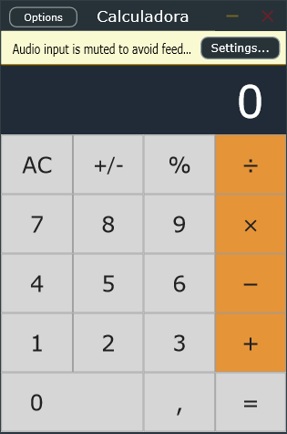

# Calculadora (VST3)

Guía de uso con explicación de cada control: [docs/GUIDE.md](docs/GUIDE.md)

## Descargar

- [Calculadora-v1.0.0-VST3-Windows.zip](download/Calculadora-v1.0.0-VST3-Windows.zip) (VST3 para Windows 64 bits)
- También en [Releases](https://github.com/papielguapo/Calculadora-PAPIELGUAPO/releases/latest)

Instalación: descomprime y copia la carpeta Calculadora.vst3 a C:\Program Files\Common Files\VST3, luego vuelve a escanear plugins en tu DAW.

Plugin VST3 / Standalone de calculadora hecho con JUCE por PAPIELGUAPO.

- Operaciones encadenadas: suma, resta, multiplicación y división.
- Porcentaje, cambio de signo, coma decimal y repetición de «=».
- Entrada con clics o teclado.
- Pasa el audio del anfitrión sin modificarlo.

## Compilar

Requiere JUCE, CMake 3.22 o posterior y Visual Studio con el compilador C++ x64.

    cmake -S . -B build -G Ninja -DJUCE_PATH="C:/JUCE"
    cmake --build build --target Calculadora1a1_VST3